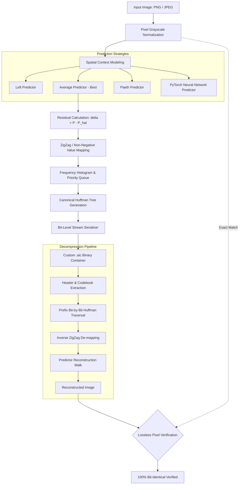

# AI-Enhanced Lossless Image Compression

[](https://en.cppreference.com/)
[](https://www.python.org/)
[](https://fastapi.tiangolo.com/)
[](https://pytorch.org/)
[](LICENSE)
[](Dockerfile)

> An end-to-end, high-performance lossless image compression system combining **Predictive Coding**, **ZigZag Transform**, and **Huffman Coding** with a custom **`.aic`** binary container format, a **C++ encoding/decoding core**, an **AI/Neural Network predictor**, and an interactive **FastAPI** web dashboard.

---

## 📌 Highlights

- **Up to 1.98× Compression Ratio & 49.6% Size Reduction**: Significant entropy reduction over raw raster payloads while guaranteeing **100% mathematical lossless reconstruction**.
- **Multi-Predictor Benchmarking**: Evaluated **Left**, **Average**, **Paeth**, and **Deep Neural Network** predictors to analyze residual probability distributions and compression efficiency.
- **Custom `.aic` Binary Format**: Engineered a low-overhead, 40-byte binary header specification packing metadata, Huffman codebook frequency tables, and bitstream sequences.
- **Bit-Level C++ Engine**: High-throughput C++ encoder and decoder pipelines with byte-aligned bit buffers and priority-queue Huffman tree generation.
- **Full-Stack REST Backend & Web UI**: FastAPI asynchronous service offering image compression, decompression, residual benchmarking, `.aic` download, and lossless pixel verification.

---

## 📊 Benchmark Results

Evaluated across high-resolution test benchmarks (1086 × 1448 grayscale raster images):

| Predictor Strategy | Predictor Type | Compression Ratio | Size Reduction (%) | Lossless Verified |
| :--- | :--- | :---: | :---: | :---: |
| **Average** | Spatial (Left + Top) / 2 | **1.985×** | **49.62%** | **PASSED** (0-error) |
| **Neural Network** | 3-Layer MLP Context Predictor | **1.975×** | **49.38%** | **PASSED** (0-error) |
| **Paeth** | Planar Gradient Predictor | **1.861×** | **46.26%** | **PASSED** (0-error) |
| **Left** | 1D Causal Left Predictor | **1.797×** | **44.34%** | **PASSED** (0-error) |

*Key finding: Spatial Average and Neural Network predictors achieve the narrowest Laplace residual distribution centered at 0, maximizing Huffman prefix-code entropy efficiency.*

---

## 🏗️ Architecture & Pipeline



---

## 📦 Custom `.aic` Binary File Format

The `.aic` format is structured for zero runtime overhead, direct memory alignment, and self-contained decoding:

```
+-----------------------------------------------------------------------+
|                       40-BYTE HEADER (AICHeader)                      |
+-------------------+-----------------+---------------------------------+
| Field             | Type            | Description                     |
+-------------------+-----------------+---------------------------------+
| magic             | char[4]         | Magic bytes "AIC1"              |
| version           | uint8_t         | Format specification version (1)|
| width             | uint32_t        | Image width in pixels           |
| height            | uint32_t        | Image height in pixels          |
| channels          | uint8_t         | 1 = Grayscale, 3 = RGB          |
| predictor         | uint8_t         | 0=Left, 1=Avg, 2=Paeth, 3=AI    |
| validBits         | uint64_t        | Exact valid bit count in stream |
| symbolCount       | uint32_t        | Unique Huffman symbols count    |
+-------------------+-----------------+---------------------------------+
|                       HUFFMAN FREQUENCY TABLE                         |
|   symbolCount * (int32_t symbol + uint32_t frequency)                 |
+-----------------------------------------------------------------------+
|                       VARIABLE-LENGTH BITSTREAM                       |
|   ceil(validBits / 8) bytes packed Huffman bitstream                  |
+-----------------------------------------------------------------------+
```

---

## 💻 Tech Stack

- **Core Algorithms & Engines**: C++11 (STL, `<queue>`, `<vector>`, bitwise serialization)
- **Deep Learning**: Python 3.11, PyTorch (Residual Context MLP)
- **Backend API**: FastAPI, Uvicorn, Python-Multipart
- **Image Processing**: Pillow (PIL), NumPy
- **Frontend**: HTML5, CSS3, Vanilla JavaScript (Fetch API, responsive canvas, live benchmarks)
- **DevOps & Containers**: Docker, Make, CMake, Render Cloud Config

---

## 🚀 Quickstart

### Prerequisites
- Python 3.10+
- G++ compiler (`g++` supporting C++11 or higher)
- Make (optional, but recommended)

### 1. Clone the Repository
```bash
git clone https://github.com/dhruvyadav12/AI-Enhanced-Lossless-Image-Compression.git
cd AI-Enhanced-Lossless-Image-Compression
```

### 2. Build the C++ Engine
Using `make`:
```bash
make
```
Or directly using `g++`:
```bash
# Windows
g++ -O3 -std=c++11 -Icpp/include cpp/src/encoder.cpp -o cpp/src/encoder.exe
g++ -O3 -std=c++11 -Icpp/include cpp/src/decoder.cpp -o cpp/src/decoder.exe

# Linux / macOS
g++ -O3 -std=c++11 -Icpp/include cpp/src/encoder.cpp -o cpp/src/encoder
g++ -O3 -std=c++11 -Icpp/include cpp/src/decoder.cpp -o cpp/src/decoder
```

### 3. Install Python Dependencies
```bash
pip install -r requirements.txt
```

### 4. Start the Application
```bash
python app.py
```
Open [http://localhost:8000](http://localhost:8000) in your web browser.

---

## 🐳 Running with Docker

Run the entire application in an isolated, multi-platform Docker container:

```bash
# Build Docker image
docker build -t ai-lossless-compression .

# Run container on port 8000
docker run -p 8000:8000 ai-lossless-compression
```

Visit `http://localhost:8000` to access the interactive web interface.

---

## ☁️ 1-Click Free Cloud Deployment (Live Demo)

### Option 1: Render.com
1. Fork or push this repository to your GitHub.
2. Sign in to [Render](https://render.com).
3. Click **New +** -> **Web Service** -> Connect your `AI-Enhanced-Lossless-Image-Compression` repository.
4. Render will automatically read [`render.yaml`](render.yaml) and configure the build and start commands.
5. Click **Create Web Service**. Your live URL will be ready in ~2 minutes!

### Option 2: Hugging Face Spaces (Docker SDK)
1. Create a new Space on [Hugging Face Spaces](https://huggingface.co/spaces).
2. Choose **Docker** as the Space SDK.
3. Push this repo to your Hugging Face Space git remote.
4. Your application runs immediately with a permanent public URL.

---

## 🔌 REST API Reference

| Endpoint | Method | Parameters | Description |
| :--- | :---: | :--- | :--- |
| `/` | `GET` | None | Serves the interactive Web Dashboard |
| `/health` | `GET` | None | Healthcheck and C++ binary status |
| `/compress` | `POST` | `file`: Image file | Compresses image to `.aic`, returns metrics |
| `/decompress` | `POST` | `file`: `.aic` file | Decompresses `.aic` to PNG with lossless check |
| `/benchmark` | `GET` | None | Returns benchmark results for all 4 predictors |
| `/download` | `GET` | None | Downloads the compressed `.aic` file |
| `/download/reconstructed` | `GET` | None | Downloads the verified reconstructed PNG |

### Example cURL: Compress Image
```bash
curl -X POST "http://localhost:8000/compress" \
  -H "accept: application/json" \
  -F "file=@data/input/test.png"
```

Response:
```json
{
  "status": "success",
  "filename": "test.png",
  "image": {
    "width": 1086,
    "height": 1448,
    "channels": 1,
    "mode": "grayscale"
  },
  "compression": {
    "original_size_bytes": 1572528,
    "compressed_size_bytes": 794151,
    "compression_ratio": 1.9801,
    "size_reduction_percent": 49.5
  },
  "predictor": "Average",
  "entropy_coder": "Huffman",
  "output_file": "compressed.aic"
}
```

---

## 📄 Resume Project Description

You can directly paste this into your resume:

```markdown
AI-Enhanced Lossless Image Compression | C++, Python, FastAPI, PyTorch, Huffman Coding
• Developed an AI-enhanced lossless image compression system using predictive coding, ZigZag transformation, and Huffman coding, achieving up to 1.98× compression ratio and 49.6% size reduction.
• Implemented and benchmarked Left, Average, Paeth, and neural-network-based predictors, analyzing residual distributions and entropy compression efficiency across strategies.
• Engineered a custom .aic binary compression format with C++ bit-level encoding and decoding pipelines, supporting image reconstruction and 100% pixel-verified lossless decompression.
• Developed a FastAPI REST backend with an interactive web UI (HTML5, CSS3, JavaScript), enabling seamless image upload, compression, decompression, residual benchmarking, and file downloads.
```

---

## 📜 License

This project is open-source under the [MIT License](LICENSE).
